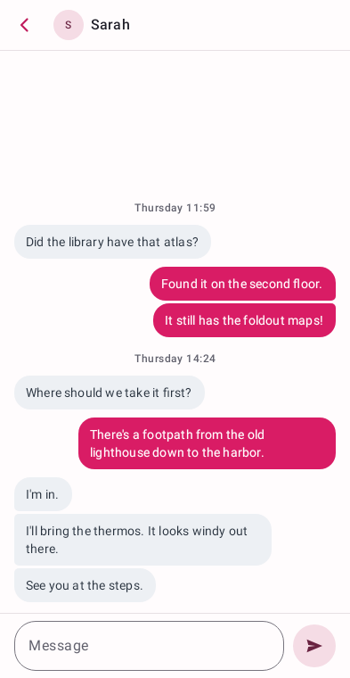
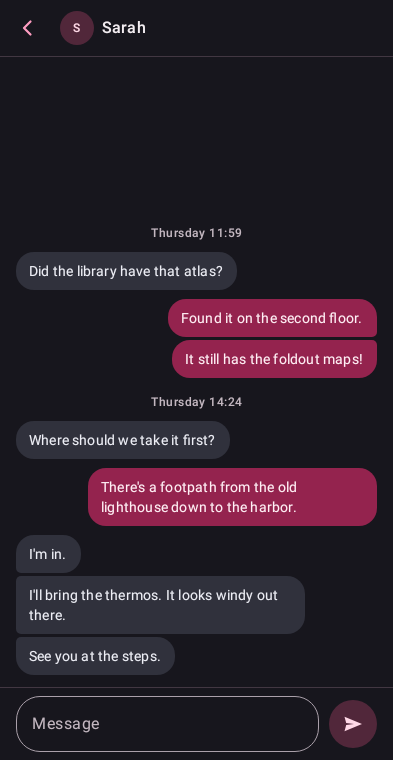
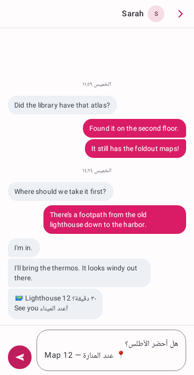

# Chat Demo

[](https://github.com/Biggemott/android-chat-demo/actions/workflows/fast.yml)
[](https://github.com/Biggemott/android-chat-demo/actions/workflows/instrumentation.yml)

Chat Demo is a native Android demo project showcasing an offline conversation between two users. It demonstrates reactive local message storage, simulated replies, persistent drafts, and an adaptive chat interface built with Kotlin and Jetpack Compose.

| English · Light | English · Dark | Arabic · RTL |
| :---: | :---: | :---: |
| [](app/src/test/screenshots/seeded-light.png) | [](app/src/test/screenshots/seeded-dark.png) | [](app/src/test/screenshots/arabic-mixed.png) |

These screenshots render the app's Compose UI using its screenshot test fixtures.

## Features

- **Conversation history.** The chat opens at the latest message, groups consecutive messages from the same sender less than 20 seconds apart, and starts a new time section after a gap longer than one hour. If history fails to load, **Retry** reloads the conversation while keeping the draft.
- **Multiline composer.** Drafts are saved locally. A failed send can restore the original text or offer it for recovery while preserving newer edits.
- **Scripted replies.** The other participant shows a typing indicator and replies after a random delay of one to three seconds. Each successful send replaces any reply still waiting to write, so a burst of quick sends typically gets one reply.
- **Scroll behavior.** New content follows the latest message when you are near the bottom. When you browse older messages, incoming replies preserve your reading position and a button takes you back to the latest message.
- **Localization and RTL support.** English and Arabic localization, right-to-left interface layouts, and mixed-direction text. Incoming and outgoing messages retain their physical alignment regardless of the interface direction.
- **Adaptive UI.** Custom light and dark themes, responsive layouts, large font support, and keyboard-aware message composition.
- **Accessibility.** TalkBack-friendly message semantics, accessible controls, typing announcements, and support for reduced motion.

## Technology stack

| Area | Tools |
| --- | --- |
| Android UI | Kotlin, Jetpack Compose, Material 3 |
| State and concurrency | AndroidX ViewModel, Kotlin coroutines and Flow |
| Storage and dependency injection | Room (SQLite), Preferences DataStore, Hilt, KSP |
| Verification | JUnit, Robolectric, Roborazzi, Compose UI tests, ktlint, Detekt, Android Lint, GitHub Actions |

## Architecture

A single activity hosts the Compose screen. In one Gradle app module, Android-independent domain models define users, conversations, and messages. Hilt wires the ViewModel to the Room repository and the draft store.

```text
Compose ── send action ──▶ ChatViewModel ── repository write ──▶ Room
Compose ◀─ UI StateFlow ── ChatViewModel ◀─ message Flow ─────── Room
```

Room is the source of truth for messages. The ViewModel maps the observed history into timeline items and exposes read-only UI state that Compose collects with lifecycle awareness. Draft edits and typing state update independently of timeline mapping.

## Getting started

Use JDK 25, Android SDK Platform 37.1, and Android SDK Build Tools 36.0.0. The app runs on Android 8.0 (API 26) and newer and targets Android 17 (API 37).

Open the repository in Android Studio, sync Gradle, and run the **app** configuration on a device or emulator. To build a debug APK from the repository root on Windows, run the wrapper command below. On macOS or Linux, use `./gradlew`.

```powershell
.\gradlew.bat :app:assembleDebug
```

To try Arabic on Android 13 or later, select Arabic for Chat Demo in the system's app language settings. On earlier versions, change the device language.

## Testing and CI

Run `.\gradlew.bat verifyProject` on Windows or `./gradlew verifyProject` on macOS or Linux. The gate runs Kotlin style and static checks, Android Lint, JVM tests with screenshot comparisons, and a debug build.

The badges show the current status of push workflows on `main`. The table records the verified results for commit `f66d3d1`.

| Workflow | Verified results |
| --- | --- |
| [Fast checks](.github/workflows/fast.yml) | 47 passing JVM tests on hosted Linux, including 11 screenshot comparisons. Separate local checks confirmed pixel-for-pixel parity for all 11 baselines on Windows and Linux. [Hosted run](https://github.com/Biggemott/android-chat-demo/actions/runs/45989084604) |
| [Instrumentation](.github/workflows/instrumentation.yml) | 35 passing instrumentation cases on each of API 26 and API 37. The API 37 emulator reported a 16 KB runtime page size. [Hosted run](https://github.com/Biggemott/android-chat-demo/actions/runs/45989084683) |

The [engineering guide](docs/engineering.md#runtime-checks) describes additional emulator checks, including the minified release on API 37 and a synthetic 1,000-message history.

## Design decisions and limits

- **Local by design.** The app models one conversation between two fixed participants. It has no accounts, network delivery, or synchronization.
- **Deterministic ordering.** Messages sort by timestamp and generated ID. Moving the device clock backwards can place a new message earlier in the conversation.
- **Separate storage for drafts and messages.** Completed writes survive a cold launch. Process death during a send can leave the stored draft and message out of step. Pending replies and the script position live in the ViewModel and reset when it is destroyed.
- **Verification scope.** The app reads the whole conversation. The 1,000-message emulator check covers chat behavior at that history size. Physical-device TalkBack verification covered English reading, navigation, sending and typing announcements, as well as Arabic RTL and spoken content. [Accessibility verification](docs/engineering.md#accessibility-verification)

## Engineering documentation

See the [engineering guide](docs/engineering.md) for the Room schema, history retry, reply scheduling, draft recovery, scroll rules, toolchain pins, and reproducible verification commands.
